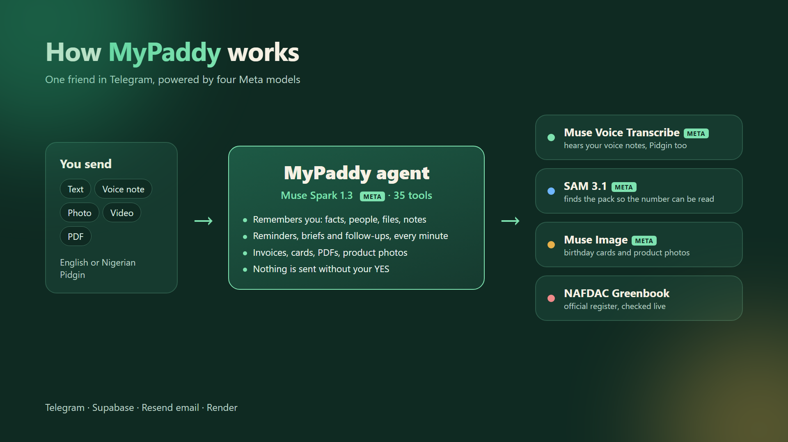

# MyPaddy

**The paddy that never forgets.**

MyPaddy is a friend in your Telegram that remembers things for you, reminds you before it is too late, checks whether a product is fake, and gets small jobs done. You talk to it the way you would text a friend: a message, a voice note in English or Nigerian Pidgin, a photo, a video or a PDF. It never sends anything on your behalf until you say YES.

- **Try it:** [t.me/mypaddyngbot](https://t.me/mypaddyngbot)
- **Demo video (3 min):** [youtu.be/MoJJxuz209I](https://youtu.be/MoJJxuz209I)
- Built for the Meta Global AI Developer Hackathon 2026, Indie track.



## What it does

**Remembers for you.** Facts (a meter number, a matric number, where you kept the spare key), people and their birthdays, files you ask it to keep, shopping and to-do lists, and notes from voice notes. Saved files are read once, so later you can ask "how much is my caution fee?" and get the answer from your own tenancy agreement. "What do you know about me?" shows everything, and anything can be deleted.

**Reminds you, and talks first.** Reminders from plain words, once or on repeat, with Done, In 1 hour and Tomorrow buttons. It picks up plans you mention in passing ("I'll submit it Thursday") and warns you when a new reminder clashes with a class or exam. A photo of a timetable, an exam timetable, an invite or a bill becomes a full set of reminders in one go. Each morning it sends a short greeting written from your day, an evening check-in at 9pm and a weekly summary on Sunday.

**Keeps you accountable.** A few hours after a task reminder you did not tick off, it asks whether you got it done. Goals ("study two hours every evening") get check-ins and a log, and a photo of your notes gets a reply on what you covered and what comes next.

**Watches your back.** Send a photo or short video of a product pack and MyPaddy reads the NAFDAC number, checks it on the official NAFDAC Greenbook register and tells you whether the number belongs to that product. Your photo comes back with the pack outlined and the number boxed, so you can see exactly what was checked. It also reviews agreements before you sign, and explains letters and bills in plain words. It never gives medical advice.

**Makes things.** Greeting cards in the colours you choose, with your friend's photo if you send one. Clean product photos for a WhatsApp Status or catalogue. Neat PDFs from anything you dictate. Invoices from a voice note, emailed to your customer after your YES, with payment reminders later.

## How it uses Meta's models

| Model | What it does in MyPaddy |
|---|---|
| **Muse Spark 1.3** | The agent. Reads every message, photo, video frame and PDF, decides what to do and calls one of 35 tools: reminders, memory, files, lists, invoices, email, cards and more. It also writes the morning, evening and weekly messages from the user's own data. |
| **Muse Voice Transcribe** | Turns voice notes into text, including Nigerian Pidgin. Each request is hinted with words this user is likely to say, such as their course codes and the names of people they saved. |
| **SAM 3.1** | Finds the pack in a drug photo. MyPaddy crops to it so Muse Spark can read the small print a second time, then boxes the number on the user's own photo. If the two readings differ, the user is told. |
| **Muse Image** | Makes greeting cards (generation) and turns a user's product photo into a clean studio shot (editing), keeping the product and its labels exactly as they are. |

## How it is built

- **Telegram** sends each message to a webhook, checked against a secret header. Duplicate deliveries are dropped and each user's messages are handled one at a time, in order.
- **The agent loop** gives Muse Spark the conversation, what the user asked MyPaddy to remember and the tool list, and runs up to six tool steps per message. Video is reduced to its sharpest frames with ffmpeg, which reads fine print far better than the raw clip.
- **The safety gate** sits between the agent and anything that leaves the chat. Tools that send email are never run by the model: they become a pending action shown to the user with Yes and No buttons. Each button is tied to its action, approvals expire after 30 minutes, a double tap cannot send twice, and there is a daily email cap.
- **A per-minute job** sends reminders that are due, the briefs and the follow-ups. Each item is claimed with a conditional update before it is sent, so overlapping runs never send the same reminder twice.
- **Data** lives in Supabase (Postgres). Every table has row level security on with no policies, so only the server's service role can read it.
- **Email** goes through Resend from a verified domain.
- **Hosting** is Render. Calls to the Meta Model API go through a small Cloudflare Worker relay (`deploy/cloudflare/worker.js`), which only forwards `/v1/` paths and checks a shared key.

## Privacy and safety

- Nothing is emailed or sent to anyone without the user's YES.
- Secrets live only in environment variables. Logs mask chat ids and never contain tokens, phone numbers or email addresses.
- Each user can see everything MyPaddy keeps about them and delete any of it.
- The drug check is a registration check only. MyPaddy never says a product is safe to take and never gives dosage or medical advice.
- Each user has a daily message limit, which keeps model costs predictable.

## Built during the hackathon

All code in this repository was written during the hackathon, 26 October to 4 November 2026, by one person. The project started on WhatsApp under the name Errand and moved to Telegram as MyPaddy on 27 October; the full history is in the commit log.

## Run it yourself

You need Node.js 22 or later, a Meta Model API key, a Telegram bot token from @BotFather, a Supabase project and, for email, a Resend account.

1. Install: `npm install`
2. Copy `.env.example` to `.env` and fill it in (see below).
3. In the Supabase SQL editor, run `src/db/schema.sql`.
4. Run locally without a public URL: set `TELEGRAM_MODE=polling` and run `npm run dev`. If a webhook was set before, remove it first with `npx tsx scripts/set-webhook.ts --delete`.
5. Deploy: `npm run build`, then `npm start` on any Node host. Point Telegram at it with `npx tsx scripts/set-webhook.ts https://your-host`.
6. Call `https://your-host/jobs/tick?key=CRON_SECRET` every minute from a scheduler such as cron-job.org. Reminders, briefs and follow-ups depend on it.

Tests: `npm test`. Type check: `npm run typecheck`.

| Variable | What it is |
|---|---|
| `META_API_KEY` | Meta Model API key |
| `META_API_BASE_URL` | Defaults to `https://api.meta.ai/v1`. Set to the relay URL when using one. |
| `META_RELAY_KEY` | Shared key for the Cloudflare relay, if used |
| `MUSE_SPARK_MODEL`, `MUSE_TRANSCRIBE_MODEL` | Model ids. Default to `muse-spark-1.3` and `muse-voice-transcribe-1.0`. |
| `TELEGRAM_BOT_TOKEN` | From @BotFather |
| `TELEGRAM_WEBHOOK_SECRET` | 32 or more letters, digits, `_` or `-`. Telegram sends it back on every webhook call. |
| `TELEGRAM_MODE` | `webhook` (default) or `polling` for local development |
| `SUPABASE_URL`, `SUPABASE_SERVICE_KEY` | Supabase project URL and service role key |
| `RESEND_API_KEY`, `EMAIL_FROM` | Email sending. `EMAIL_FROM` needs a domain verified in Resend. |
| `DEV_EMAIL_TO` | Optional. Sends every email to this address instead, for testing. |
| `CRON_SECRET` | 32 or more characters. Protects the job routes. |
| `DAILY_MESSAGE_LIMIT` | Messages per user per Lagos day. Defaults to 60. |
| `OWNER_CHAT_ID` | Optional. The one chat allowed to use the `/demo` commands used for recording the demo. |
| `LOG_LEVEL` | Defaults to `info` |

## Project layout

```
src/
  ai/          Muse Spark agent loop, prompts, voice transcription, vision and SAM 3.1
  telegram/    webhook, polling, sending, file downloads
  safety/      the approval gate
  tools/       the 35 tools the agent can call
  jobs/        reminders, briefs, follow-ups and payment reminders
  product/     NAFDAC Greenbook lookup, verdicts and the boxed photo
  invoice/     invoice and document PDFs
  media/       ffmpeg helpers for voice notes, video frames and photos
  db/          schema, migrations and data access
deploy/cloudflare/  the Meta Model API relay
scripts/       webhook setup and a local message simulator
test/          unit tests
```

## License

MIT. See [LICENSE](LICENSE).
